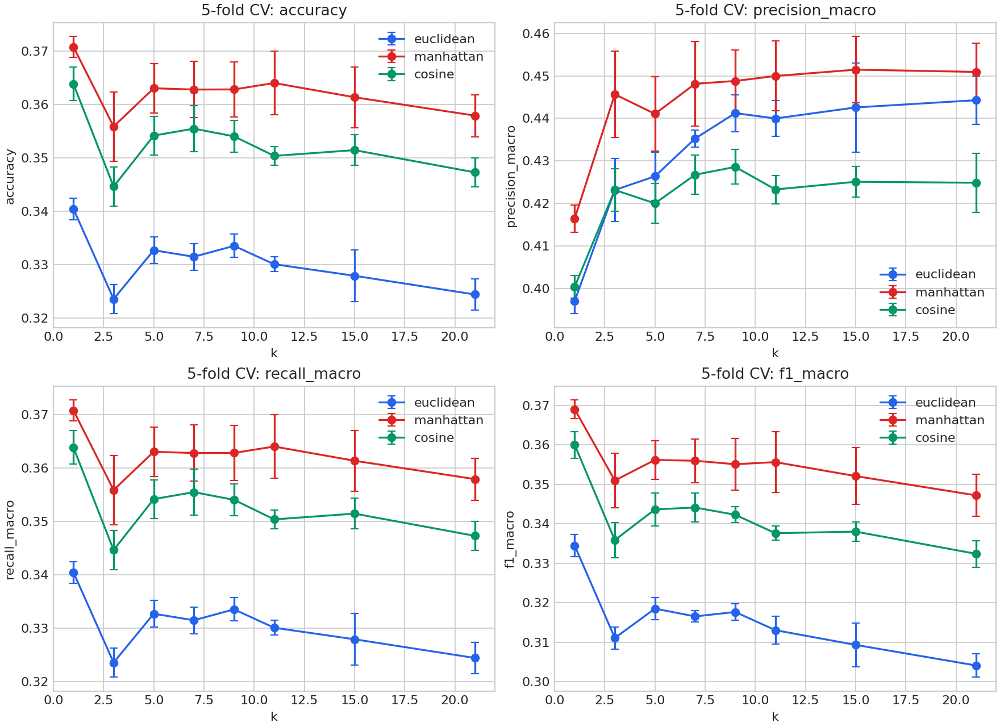

# 01. 기본 KNN

모든 이웃에 동일한 1표를 부여하고, 최다 득표가 동률이면 가장 작은 클래스 번호를 선택했습니다. k는 기존 8개 값입니다.

단위는 %입니다. 정밀도·재현율·F1은 Macro 평균이며, CV는 5개 fold의 평균 ± 표본 표준편차(ddof=1)입니다.

전체 **24개 설정**, **120개 fold 결과**, 거리별 CV 최적 모델의 **3개 테스트 결과**입니다.

| 투표 방식 | 거리 | k | CV 정확도 | 테스트 정확도 | 테스트 정밀도 | 테스트 재현율 | 테스트 F1 |
| --- | --- | --- | --- | --- | --- | --- | --- |
| 다수결 + 작은 클래스 번호 | Manhattan | 1 | 37.08 ± 0.19 | 38.59 | 43.33 | 38.59 | 38.62 |

[전체 CV 결과](cv_results.md) · [전체 fold 결과](fold_results.md) · [테스트 결과](test_results.md) · [클래스별 결과](class_results.md) · [혼동행렬](confusion_matrices.md)

[실행 코드](../../experiment.py) · [실험 목록](../README.md)
