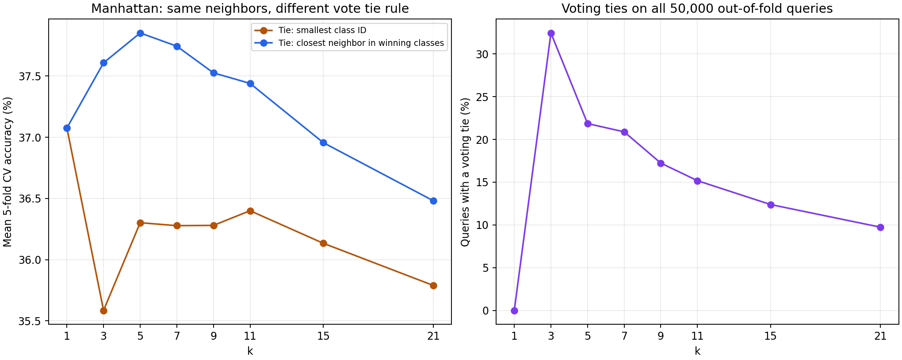

# 02. 동률 처리 영향 분석

같은 Manhattan 이웃 목록에 작은 클래스 번호 선택과 최근접 동률 해결을 각각 적용해 비교했습니다. 기존 8개 k를 분석했습니다.

k=5에서 동률은 **21.86%**, CV 정확도는 **36.30% → 37.85%**였습니다. 이 분석의 평가는 CV 전용입니다.

[동률 발생·성능 변화](tie_results.md) · [전체 fold 결과](fold_results.md) · [4개 CV 지표](cv_results.md)

[실행 코드](../../experiment.py) · [실험 목록](../README.md)

