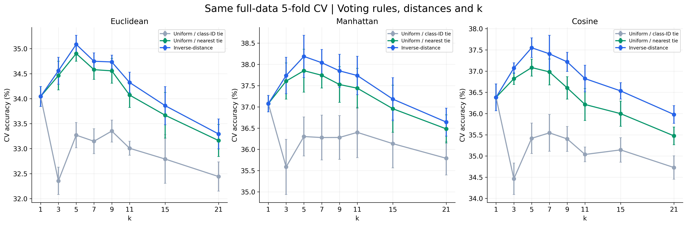

# 03. 투표 방식 3종 비교

세 투표 방식을 동일한 이웃·거리·k·fold 조건에서 비교했습니다. 각 방식마다 3개 거리 × 8개 k를 평가했습니다.

단위는 %입니다. 정밀도·재현율·F1은 Macro 평균이며, CV는 5개 fold의 평균 ± 표본 표준편차(ddof=1)입니다.

전체 **72개 설정**, **360개 fold 결과**, 거리별 CV 최적 모델의 **9개 테스트 결과**입니다.

| 투표 방식 | 거리 | k | CV 정확도 | 테스트 정확도 | 테스트 정밀도 | 테스트 재현율 | 테스트 F1 |
| --- | --- | --- | --- | --- | --- | --- | --- |
| 다수결 + 작은 클래스 번호 | Manhattan | 1 | 37.08 ± 0.19 | 38.59 | 43.33 | 38.59 | 38.62 |
| 다수결 + 최근접 동률 해결 | Manhattan | 5 | 37.85 ± 0.51 | 39.21 | 45.60 | 39.21 | 38.90 |
| 거리 역수 가중 투표 | Manhattan | 5 | 38.19 ± 0.50 | 39.50 | 45.92 | 39.50 | 39.22 |

[전체 CV 결과](cv_results.md) · [전체 fold 결과](fold_results.md) · [테스트 결과](test_results.md) · [클래스별 결과](class_results.md) · [혼동행렬](confusion_matrices.md)

[투표 방식별 최적 모델 비교](comparison.md)

[실행 코드](../../experiments/03_voting_comparison/run.py) · [실험 목록](../README.md)
