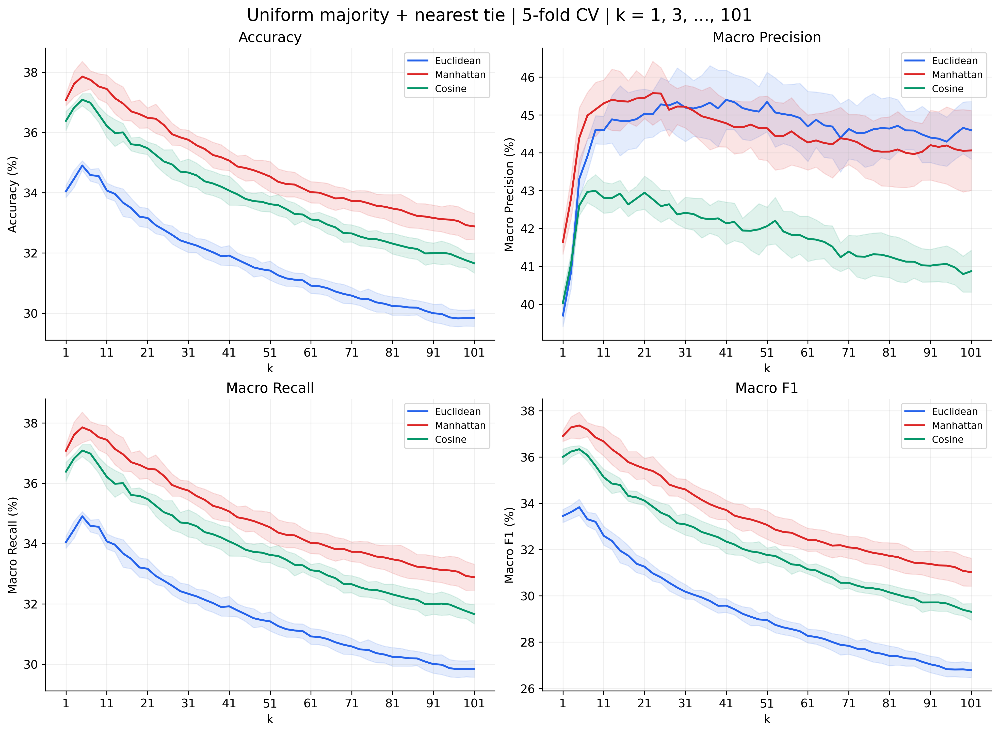

# 04. k=101까지 확장

다수결 + 최근접 동률 해결 방식으로 k=1,3,…,101의 모든 홀수 51개를 평가했습니다. 거리 가중 투표의 확장은 수행하지 않았습니다.

단위는 %입니다. 정밀도·재현율·F1은 Macro 평균이며, CV는 5개 fold의 평균 ± 표본 표준편차(ddof=1)입니다.

전체 **153개 설정**, **765개 fold 결과**, 거리별 CV 최적 모델의 **3개 테스트 결과**입니다.

| 투표 방식 | 거리 | k | CV 정확도 | 테스트 정확도 | 테스트 정밀도 | 테스트 재현율 | 테스트 F1 |
| --- | --- | --- | --- | --- | --- | --- | --- |
| 다수결 + 최근접 동률 해결 | Manhattan | 5 | 37.85 ± 0.51 | 39.21 | 45.60 | 39.21 | 38.90 |

[전체 CV 결과](cv_results.md) · [전체 fold 결과](fold_results.md) · [테스트 결과](test_results.md) · [클래스별 결과](class_results.md) · [혼동행렬](confusion_matrices.md)

[투표 방식별 최적 모델 비교](comparison.md)

[탐색 범위 확장 전후 비교](range_comparison.md)

[실행 코드](../../experiments/04_k101/run.py) · [실험 목록](../README.md)
